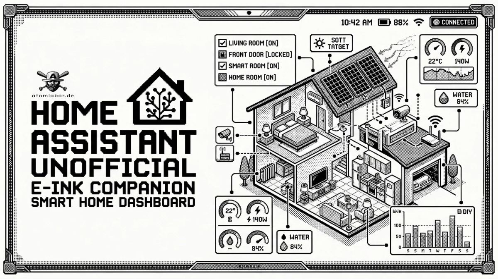

# Home Dashboard



Your Home Assistant, calm and readable on e-ink. An unofficial Home Assistant companion for the **Xteink X4 Pro** and **X4 Classic**, built with InkApp AI Studio.

**[Download homedash.xtapp](dist/homedash.xtapp)** · version 1.3.2

[](https://ko-fi.com/atomlabor)

## What it does

- **Home** – a large card with your key values, what is playing right now, and your lights and switches as tiles. Tap a tile to switch it; lights that are on are shown inverted.
- **Music** – the current album cover, title and artist with previous, play/pause and next. Works with Spotify and other media players in Home Assistant.
- **Sensors** – temperature, humidity, CO2, power, energy, light and battery at a glance.
- **Settings** – choose which sensors and switches appear on the dashboard and which values go on the lock screen. English and German.
- **Lock screen** – date, a large clock, up to six values, what is playing with its cover and which lights are on. The clock updates every minute. How often the locked device fetches fresh values is up to you: a slider in Settings goes from every minute to once an hour (default 5 minutes). Between fetches Wi-Fi stays off. If the network fails, the last values stay with an offline marker.
- **Your own order** – arrange switches and sensors with the arrows in Settings → Order of tiles. The first three sensors fill the big card on Home; tap the card to rearrange them.
- **PIN lock** – optional. With it on, the app opens with a keypad and shows nothing until the right PIN is entered. Choose whether it locks every time or after 1, 5 or 15 minutes away, change the PIN or lock right away. After five wrong tries the keypad pauses for 30 seconds. Only a salted hash is stored, never the digits.

While the app is open it refreshes every 30 seconds.

On the X4 Pro you tap; the side keys turn pages. On the X4 Classic the keys do everything: left/right switch the area, up/down move the focus, OK acts.

## Setup

You need a Home Assistant server reachable from your Wi-Fi or the internet. Then pick one of three ways:

1. **Sign in on the device** with your Home Assistant user name and password. Only a sign-in key is stored, never your password.
2. **Paste a long-lived access token** (Home Assistant: Profile → Security).
3. **Put a `homeassistant.txt`** into the app folder, see [homeassistant.example.txt](homeassistant.example.txt):

```
url = https://your-home-assistant.example
token = your-long-lived-access-token
```

Never commit your own `homeassistant.txt`; it holds your key in plain text.

### Forgot the PIN?

Put an empty file named `pin_reset.txt` into the app folder and open the app. The PIN is removed and the file is deleted.

## Install

Copy `dist/homedash.xtapp` onto your X4 or install it from InkApp AI Studio. The app needs the `net` permission and API 2.23 or newer.

## Project layout

| Path | What |
| --- | --- |
| `manifest.json` | App manifest (app_id `homedash`) |
| `index.lua` | Dashboard: Home, Music, Sensors, Settings |
| `lockscreen.lua` | Lock screen with live values |
| `app/ha.lua` | Home Assistant access, sign-in and caching |
| `app/i18n.lua`, `lang/` | Translations |
| `app/icons.lua`, `assets/` | Icons |
| `dist/homedash.xtapp` | Ready-to-install package |
| `inkapp.json` | Entry for the [Touch Licorice apps](https://omer-faruq-xteink.github.io/touch-licorice-apps/) list |

## License

MIT, see [LICENSE](LICENSE). Not affiliated with Home Assistant or Nabu Casa.
